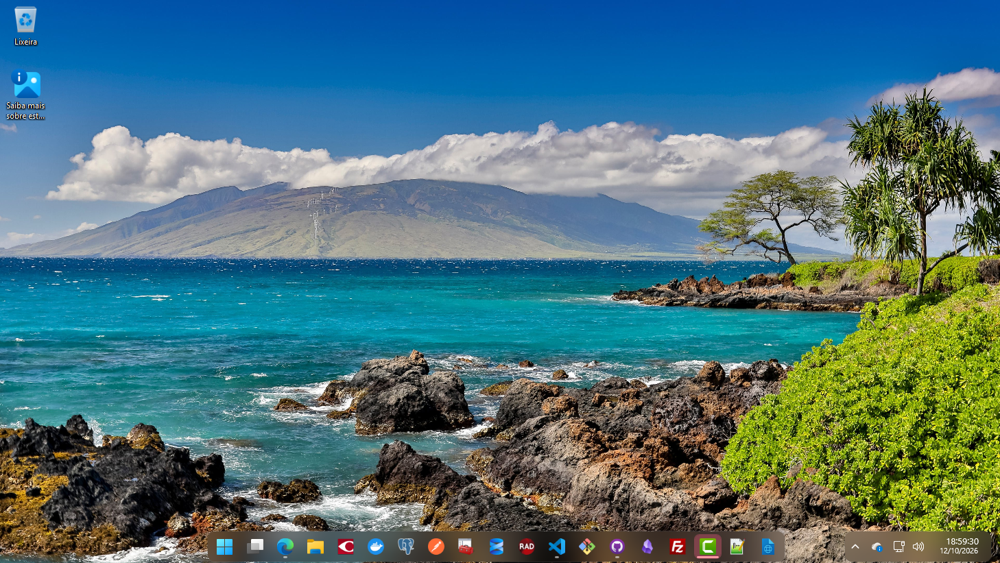
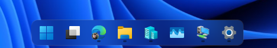
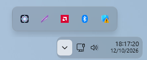

# wintaskbar

Personaliza a barra de tarefas do Windows 11 x64 com uma Dock flutuante,
cantos arredondados, blur e uma Tray separada para relógio e ícones do sistema.

## Aparência

A Dock e a Tray ficam como duas superfícies separadas, com blur, cantos
arredondados e borda em gradiente (Theme padrão `default`, tema claro do Windows):







https://github.com/user-attachments/assets/4f09fac8-91bf-4a5b-b2f7-cbbf65e4b1ff

## Desempenho

O wintaskbar foi pensado desde o início para ser escrito em **Go**: o Agent é um
único executável nativo, sem runtime nem serviço extra instalado. A única parte
que precisa rodar dentro do `explorer.exe` é o TAP, mantido em C++ e reduzido ao
mínimo (ele só aplica o tema que o Agent já compilou).

Medido no Windows 11 (build 26300), com o tema padrão e o aplicativo na bandeja:

| Item | Valor |
|---|---|
| Memória do Agent | cerca de 19 MB |
| CPU em repouso | cerca de 0,2% de um núcleo |
| `wintaskbar.exe` | 3,1 MB |
| `tap.dll` | 1,6 MB |

O Agent não fica consultando janelas: só verifica o explorer a cada 2 segundos,
para reanexar o TAP se ele reiniciar. O blur é desenhado pelo compositor do
próprio Windows. Os valores acima são de uma máquina de desenvolvimento e não
incluem a memória que o TAP usa dentro do explorer.

## Usar sem terminal e sem Go

- **Instalador:** abra `wintaskbar-setup.exe` com duplo clique. Ele instala para
  o usuário atual, cria atalhos na área de trabalho e no menu Iniciar e abre o aplicativo.
- **Portátil:** extraia `wintaskbar-portable.zip` e abra `wintaskbar.exe`.
  Mantenha `tap.dll` na mesma pasta do executável.

Go, compilador C++ e privilégios de administrador não são necessários
para usar os arquivos já compilados. O aplicativo roda na sessão do usuário.

Ao abrir, o aplicativo aplica o tema e fica na bandeja do Windows (o ícone pode
estar em **Mostrar ícones ocultos**). Clique com o botão direito no ícone para abrir o menu.
O clique esquerdo não abre o menu; a ativação pelo teclado continua disponível:

O menu acompanha o modo claro/escuro do Windows, com apresentação compacta,
sem ícones nas ações e com cantos/sombra fornecidos pelo DWM. Usa Segoe UI
de 12 pixels lógicos, linhas de 24 pixels e largura ajustada ao texto.
Ele abre junto ao ícone
e respeita a escala e a área útil do monitor. Setas, Tab/Shift+Tab, Home/End,
Enter e Espaço navegam/executam as ações; Esc ou clicar fora fecha o menu.
Ao abrir com o mouse, o menu não assume o foco: o painel de ícones ocultos
permanece aberto atrás dele até uma ação ou interação externa. Não há prazo
para fechar o menu. A abertura pelo teclado continua usando foco nativo.
Os nomes, estados desabilitados e marcações são expostos pelos controles
nativos; opções de liga/desliga incluem “ativado” ou “desativado” no nome
acessível. Em alto contraste ou se o menu não couber na tela, o menu clássico
do sistema é usado. As opções e suas ações continuam iguais.

| Opção | Comportamento |
|---|---|
| Aplicar / recarregar tema | Valida o tema, reinicia o Explorer e aplica as alterações. |
| Desativar tema | Para o monitoramento e reinicia o Explorer para restaurar a barra. |
| Editar tema | Cria a cópia editável, se necessário, e abre no Bloco de Notas. Após salvar, use Aplicar / recarregar. |
| Ocultar automaticamente | Alterna a configuração nativa da barra de tarefas. |
| Iniciar com o Windows | Ativa ou desativa a inicialização automática para o usuário atual, por uma tarefa agendada de logon (sem o atraso da chave `Run`; se a tarefa não puder ser criada, usa a chave `Run`). |
| Abrir pasta de logs | Abre a pasta dos logs do Agent e do TAP. |
| Ver último erro | Mostra o último erro completo, inclusive as linhas inválidas do tema. |
| Sair e restaurar a barra | Para o monitoramento, restaura a barra e encerra o aplicativo. |

Abrir novamente exibe o menu da instância existente. Enquanto ativo, o aplicativo
reaplica o tema quando o Explorer reinicia. Desativar vale para a sessão atual;
abrir o aplicativo novamente ativa o tema. A inicialização automática é opcional
e começa desligada. Na versão portátil, ative-a depois de escolher a pasta definitiva.

As consultas de inicialização em segundo plano rodam sem criar janela de console,
evitando interferência desse console no foco do painel de ícones ocultos.

A restauração/reaplicação reinicia o Explorer; a barra e a área de trabalho podem
sumir brevemente, e janelas do Explorador de Arquivos podem fechar.
A opção de auto-ocultar é independente e não é alterada ao sair.

Para a Dock aparecer sobre os apps maximizados, ative **Ocultar automaticamente**.
Sem essa opção, o Windows continua reservando a faixa da barra de tarefas.
Se usar outra ferramenta que estilize a barra de tarefas, desative-a antes de aplicar
este aplicativo, para evitar que ambas alterem os mesmos elementos.

Para desinstalar, use **Configurações → Aplicativos → Aplicativos instalados →
wintaskbar → Desinstalar**. O desinstalador restaura a barra, remove a inicialização
automática, os atalhos e os executáveis. Seus temas e logs são preservados.

## Temas

O tema padrão mantém a mesma folga de 1 pixel lógico acima e abaixo da Dock
e da Tray, para separá-las visualmente da janela maximizada e da borda da tela.
A variável `VerticalGap` no YAML controla as duas margens juntas, e `DockTrayGap`
define a folga mínima antes da Tray. A regra `DockLayoutGap: '$DockTrayGap'`
em `Taskbar.TaskbarFrame` ativa o layout adaptativo: com espaço, a Dock fica
centralizada; quando necessário, desloca-se para a esquerda e limita a largura
para que o Windows possa apresentar o botão de overflow (`…`).

`DockLayoutGap` aceita de 0 a 1000 pixels lógicos, inclusive frações. O limite
é medido até o início de `TrayNotifyWnd`; o conteúdo da Tray pode ter margem
interna adicional. A regra exige um quadro sem transformação personalizada.
Se o TAP não identificar com segurança a Taskbar e sua Tray, preserva o layout
do tema e registra a limitação no log. A validação visual em três larguras
deve ser feita na sessão Windows de destino; testes de cálculo não a substituem.

Temas editáveis existentes não são sobrescritos: para adotar o comportamento,
adicione `DockLayoutGap: '$DockTrayGap'` à regra de `Taskbar.TaskbarFrame` e
remova a antiga margem direita `$DockTrayGap` de `Grid#RootGrid`, mantendo
`Margin: '0,$VerticalGap,0,$VerticalGap'`. Atualize o Agent e o TAP juntos:
o Agent passa a emitir a versão 2 do contrato; o TAP novo também lê a versão 1.

O tema padrão `default` vem embutido no Agent. O menu **Editar tema** cria uma
cópia em `%APPDATA%\wintaskbar\theme.yaml`. Quando esse arquivo existe, ele é
usado no lugar do padrão. Exemplo de um tema mínimo:

```yaml
name: meu-tema
variables:
  Background: '<Blur Amount="20" TintColor="#202020" TintOpacity="0.15" />'
rules:
  - selector: 'Taskbar.TaskbarFrame > Grid#RootGrid'
    styles:
      Margin: '0,0,0,4'
      CornerRadius: '10'
      Background: '$Background'
```

O Agent valida seletores, variáveis e valores antes de reiniciar o Explorer.
Se houver erro, o menu **Ver último erro** mostra os detalhes; corrija, salve e
use **Aplicar / recarregar tema** novamente. XAML bem formado ainda pode conter
propriedades ou recursos que a versão do Windows não suporta; o TAP registra
essas falhas no log.

Seletores aceitam tipo, `#Nome`, filho direto `>`, alternativas separadas por
vírgula e atributos `Text` / `AutomationProperties.AutomationId`.
Estados visuais (`@CommonStates`) e expressões dinâmicas não são suportados.
O blur aceita intensidade de 0 a 250, cor literal ou recurso do tema e opacidade.
Se os efeitos avançados do Windows estiverem desligados, usa uma cor sólida.

Arquivos do usuário:

- `%APPDATA%\wintaskbar\theme.yaml`: tema editável.
- `%LOCALAPPDATA%\wintaskbar\theme.compiled`: contrato gerado pelo Agent.
- `%LOCALAPPDATA%\wintaskbar\tap.log`: regras aplicadas e falhas de propriedades.
- `%LOCALAPPDATA%\wintaskbar\agent.log`: erros do aplicativo da bandeja.
- `%LOCALAPPDATA%\Programs\wintaskbar`: instalação por usuário.

## Como funciona

```text
Duplo clique / inicialização com o Windows
  → Agent Go: bandeja + monitoramento do Explorer
  → valida theme.yaml (ou usa o tema padrão)
  → grava theme.compiled com seletores decompostos e valores resolvidos
  → encontra o Explorer pela janela Shell_TrayWnd
  → InitializeXamlDiagnosticsEx carrega o TAP
  → TAP C++/WinRT acompanha os elementos XAML
  → aplica as regras do tema compilado à barra de tarefas
```

O TAP lê o contrato compilado, sem reinterpretar seletores ou variáveis.

| Diretório | Responsabilidade |
|---|---|
| `cmd/wintaskbar` | Composição do aplicativo e comandos de desenvolvimento. |
| `cmd/setup` | Instalador independente, com o Agent e o TAP embutidos. |
| `internal/modules/agent` | Aplicação, restauração, monitoramento e transporte da bandeja. |
| `internal/modules/theme` | Modelo, validação, leitura YAML e compilação de temas. |
| `internal/platform/windows` | APIs nativas, bandeja, inicialização automática e shell. |
| `tap` | Componente C++/WinRT carregado no Explorer. |

## Desenvolvimento e distribuição

O `Makefile` centraliza as tarefas de desenvolvimento. Use **GNU Make** no Windows
e execute os comandos na raiz do projeto:

```powershell
make help       # lista os alvos; também é o padrão de make
make build      # aplicativo da bandeja + TAP + CLI
make release    # instalador completo + ZIP portátil
make check      # todos os testes (Go/COM, instalador, C++, bandeja) e go vet
make test-ui    # teste temporário da bandeja, sem aplicar tema
make fmt        # formata os fontes Go
make run        # compila e abre o aplicativo, aplicando o tema
make stop       # restaura a barra e encerra a instância da bandeja
make clean      # remove os produtos conhecidos do build
```

Os alvos `agent`, `cli`, `tap`, `test-go`, `test-tap` e `vet` também podem ser
executados separadamente. `make clean` preserva temas do usuário, caches,
toolchain e arquivos não pertencentes ao build. Encerre o aplicativo antes de
recompilar ou limpar a DLL carregada.

Se outro `make.exe` tiver prioridade no `PATH` (como o do Embarcadero), use o
caminho do GNU Make. Exemplo para uma instalação via Chocolatey:

```powershell
& 'C:\ProgramData\chocolatey\bin\make.exe' check
```

Os scripts PowerShell continuam disponíveis para quem não usa Make.

`make check` prepara seus próprios binários e instalador em `bin/check`,
evitando os arquivos em uso pelo aplicativo. Executa `go vet`, os testes de
contrato C++ e toda a suíte Go sem usar o cache de resultados. O teste da bandeja
cria e remove um ícone temporário isolado, mesmo com o aplicativo aberto. Não
instala o aplicativo, não aplica temas e não reinicia o Explorer.

Para **compilar**: Windows x64, Go 1.22+ e toolchain clang/MinGW-w64 com headers
C++/WinRT e `xamlom.h`. `scripts/build-tap.ps1` procura `$env:TWS_CLANG`,
`.toolchain/Compiler/bin/clang++.exe`.

```powershell
powershell -NoProfile -File scripts\build-release.ps1
```

Saídas:

- `bin\wintaskbar-setup.exe`: instalador completo.
- `bin\wintaskbar-portable.zip`: distribuição portátil.
- `bin\release\wintaskbar.exe`: aplicativo sem janela de terminal.
- `bin\wintaskbar-cli.exe`: versão com saída de console para desenvolvimento.

O build não instala o aplicativo, não aplica temas e não altera a inicialização
do Windows. Os binários locais não têm assinatura de código.

O ícone (uma roseta de oito pétalas de vidro) fica em `assets/icon.svg` e é
embutido nos executáveis pelos arquivos `icon_windows_amd64.syso` de `cmd/wintaskbar`
e `cmd/setup`. Para redesenhá-lo, edite `scripts/build-icon.ps1` e rode-o: ele
gera `assets/wintaskbar.ico` e recompila os `.syso` (precisa do `llvm-windres`).

```powershell
go test ./...
go vet ./...
powershell -NoProfile -File scripts\test-tap.ps1
# Testar a DLL recém-gerada e a bandeja, sem anexar ao Explorer:
$env:WINTASKBAR_TEST_TAP = (Resolve-Path bin\release\tap.dll).Path
$env:WINTASKBAR_TEST_TRAY = '1'
go test ./internal/platform/windows/...
```

O teste C++ lê o mesmo arquivo de referência conferido pelo compilador Go e
verifica seletores, atributos, escapes, parâmetros de blur e rejeição de arquivos
inválidos, além do cálculo do layout adaptativo. Os testes Go cobrem os casos de
uso, o contrato COM e o ciclo da bandeja.

`WINTASKBAR_TEST_TRAY=1` também exercita o menu moderno com ações fictícias:
teclado, clique, opções desabilitadas, atualização de estado, fechamento e
recursos GDI após reaberturas. Não executa comandos reais do aplicativo.
Para gerar capturas da janela de teste nos dois temas, defina
`WINTASKBAR_MENU_CAPTURE_DIR` com uma pasta de saída e rode
`go test ./internal/platform/windows/tray -run TestNativeMenuAppearance -count=1`.

Para medir a Dock, o overflow, a Tray e Mostrar área de trabalho sem clicar nem
alterar o sistema, use `powershell -File scripts\measure-taskbar.ps1 -Json`.
Repita após ajustar manualmente a largura do visualizador remoto. Confira
`OverflowBeforeTray`, `OverflowGap` e `FrameCenterOffset` (até ±2 px em tela
larga), mantendo os mesmos apps fixados. Overflow ausente é registrado como
`null`, não como aprovação automática do critério.

Comandos opcionais para desenvolvimento:

```powershell
.\bin\wintaskbar-cli.exe pid
.\bin\wintaskbar-cli.exe apply
.\bin\wintaskbar-cli.exe watch
.\bin\wintaskbar-cli.exe theme check
.\bin\wintaskbar-cli.exe theme init
.\bin\wintaskbar-cli.exe theme apply
.\bin\wintaskbar-cli.exe autohide status
.\bin\wintaskbar-cli.exe stop  # encerra a instância da bandeja e restaura a barra
```

Encerre a instância da bandeja antes de testar `apply`, `watch` ou `theme apply`
pelo terminal. Não use dois monitores simultâneos. A DLL carregada fica presa ao
processo do Explorer; saia pelo menu antes de substituí-la.

## Limitações técnicas

`InitializeXamlDiagnosticsEx` é uma API não documentada e a árvore XAML pode mudar
entre versões do Windows. O TAP ainda não libera todas as referências de elementos
mantidas pelo diagnóstico; isso precisa evoluir para uso prolongado. O blur não
implementa saturação, luminosidade, ruído ou reação à economia de energia.

## Origem

O tema padrão (`default`) é original deste projeto. A técnica de anexação usa a API
de diagnóstico XAML do Windows, que o TAP implementa do zero. Consulte `LICENSE` e
`THIRD_PARTY_NOTICES.md` (bibliotecas e ferramentas de terceiros).
